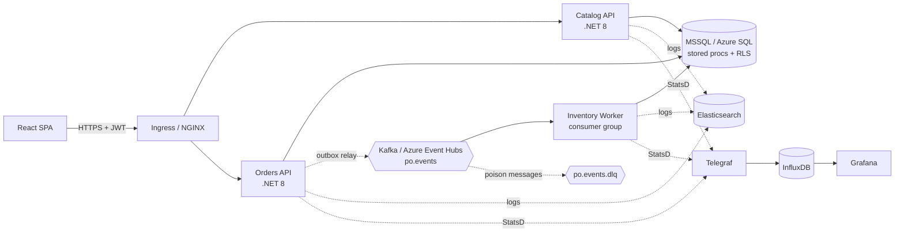
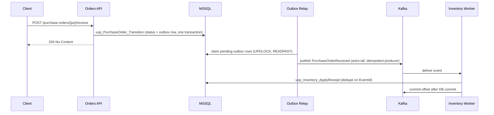

<div align="center">

# SupplyMesh

### Multi-Tenant Supply Chain Execution & Operations Platform

Event-driven, secure, multi-tenant microservices for catalog management, procurement and inventory.


**C# → .NET Core → Web API → MSSQL → Stored Procedures → Kafka → Azure → Kubernetes → React → Monitoring → Production Troubleshooting**

</div>

---

## Table of contents

1. [Overview](#overview)
2. [Architecture](#architecture)
3. [Key engineering decisions](#key-engineering-decisions)
4. [Tech stack](#tech-stack)
5. [Repository layout](#repository-layout)
6. [Getting started](#getting-started)
7. [API reference](#api-reference)
8. [Event flow](#event-flow-receiving-a-purchase-order)
9. [Database design](#database-design)
10. [Security](#security)
11. [Observability](#observability)
12. [Production troubleshooting](#production-troubleshooting)
13. [Deployment (Azure and Kubernetes)](#deployment-azure-and-kubernetes)
14. [Testing and CI](#testing-and-ci)
15. [Roadmap](#roadmap)
16. [Author](#author)

---

## Overview

SupplyMesh models the core of a supply chain platform: retailers (tenants) manage a **supplier catalog**, raise **purchase orders** through a guarded lifecycle, and see **inventory** update asynchronously when goods are received.

It is built to demonstrate production-minded backend engineering rather than CRUD:

- **Tenant isolation enforced in the database** (SQL Row-Level Security), not only in application code.
- **Reliable messaging**: transactional outbox, idempotent consumers, retries and a dead-letter topic.
- **Stored-procedure-centric data access** with explicit, tunable query plans.
- **Operable by design**: structured logs, correlation IDs, metrics pipeline, dashboards and a troubleshooting runbook.
- **Cloud-native delivery**: containers, Kubernetes manifests, Bicep infrastructure, CI/CD.

## Architecture



| Service | Responsibility |
|---|---|
| `SupplyMesh.Catalog.Api` | Catalog (Catman) search and upsert, suppliers |
| `SupplyMesh.Orders.Api` | Purchase-order lifecycle, inventory read model, outbox relay |
| `SupplyMesh.Inventory.Worker` | Consumes PO events and applies stock receipts idempotently |
| `SupplyMesh.Shared` | Tenancy, security, Kafka config, outbox relay, metrics, logging |
| `web/` | React + TypeScript operations console |

## Key engineering decisions

| Concern | Decision | Rationale |
|---|---|---|
| Multi-tenancy | Shared database, `TenantId` column, **SQL Row-Level Security**. Tenant is read only from the validated JWT `tid` claim. | Isolation holds even if application code has a bug. |
| Data access | Dapper + **stored procedures** (table-valued parameters, `MERGE`, keyset pagination, covering indexes). | Predictable plans, easy to profile and tune. |
| Consistency | **Transactional outbox** plus idempotent consumer (`ProcessedEvent`). | Avoids the dual-write problem; at-least-once delivery gives exactly-once effect. |
| Ordering | Kafka message key = `PoNumber`. | All events for one PO stay in one partition, in order. |
| Failure handling | 3 retries with backoff, then DLQ. Offset committed only after the DB commit. | A poison message never blocks a partition. |
| Portability | Same Kafka client for local Kafka and Azure Event Hubs (Kafka endpoint). | One code path across environments. |
| Scalability | Stateless APIs with HPA (3 to 12 replicas), PodDisruptionBudget, zone spread. | Horizontal scale and safe rollouts. |

## Tech stack

| Layer | Technology |
|---|---|
| Backend | C#, .NET 8, ASP.NET Core Web API, Dapper, Serilog, Swagger/OpenAPI |
| Database | Microsoft SQL Server (T-SQL stored procedures, Row-Level Security, TVPs) |
| Messaging | Apache Kafka, Azure Event Hubs (Kafka protocol), Confluent.Kafka |
| Frontend | React 18, TypeScript, Vite, Vitest |
| Cloud | Azure: AKS, ACR, Event Hubs, Azure SQL, Key Vault, Application Insights; Bicep |
| Containers | Docker, Docker Compose, Kubernetes |
| Observability | Elasticsearch, Telegraf, InfluxDB, Grafana |
| Testing | NUnit, Moq, Vitest |
| Scripting | PowerShell, Python, Shell |
| CI/CD | GitHub Actions (OIDC to Azure) |

## Repository layout

```
SupplyMesh/
├── src/
│   ├── SupplyMesh.Shared/          # tenancy, auth, Kafka, outbox relay, metrics, logging
│   ├── SupplyMesh.Catalog.Api/
│   ├── SupplyMesh.Orders.Api/
│   └── SupplyMesh.Inventory.Worker/
├── tests/SupplyMesh.Tests/         # NUnit tests
├── db/migrations/                  # schema, RLS, stored procedures, seed data
├── web/                            # React + TypeScript SPA
├── deploy/
│   ├── k8s/                        # Deployments, HPA, PDB, Ingress, NetworkPolicies
│   ├── azure/main.bicep            # AKS, ACR, Event Hubs, Azure SQL, Key Vault, App Insights
│   └── observability/              # Telegraf config, Grafana provisioning and dashboard
├── ops/scripts/                    # PowerShell, Python, Shell diagnostics; SQL DMV queries
├── docs/                           # Architecture, troubleshooting runbook, TDD notes
├── docker-compose.yml              # Full local stack
└── .github/workflows/ci.yml
```

## Getting started

### Prerequisites

- Docker Desktop (or Docker Engine + Compose v2)
- .NET 8 SDK
- Node.js 20+

### Run the full stack

```bash
git clone https://github.com/<your-username>/SupplyMesh.git
cd SupplyMesh
docker compose up -d --build
```

| Component | URL |
|---|---|
| Web console | http://localhost:8080 |
| Catalog API (Swagger) | http://localhost:5001/swagger |
| Orders API (Swagger) | http://localhost:5002/swagger |
| Grafana | http://localhost:3000 |
| InfluxDB | http://localhost:8086 |
| Elasticsearch | http://localhost:9200 |

The `db-init` container applies `db/migrations/*.sql` and seeds two demo tenants (`Acme Retail`, `Globex Grocers`).

### Authentication for local use

APIs validate JWTs issued by Microsoft Entra ID. Set `Auth__Authority` and `Auth__Audience` for your tenant, or point them at a local OIDC issuer. For the web app, set a token in `web/.env.local`:

```
VITE_DEV_TOKEN=<access token containing tid and scp claims>
```

Required token claims: `tid` (tenant id) and `scp` containing the scopes below.

### Develop individual pieces

```bash
dotnet build
dotnet test
cd web && npm install && npm run dev
```

## API reference

Base path: `/api/v1`. All endpoints require a bearer token and are tenant-scoped.

| Method | Endpoint | Scope | Description |
|---|---|---|---|
| GET | `/catalog?category=&after=&pageSize=` | `catalog.read` | Keyset-paginated catalog search |
| PUT | `/catalog` | `catalog.write` | Upsert a catalog item by SKU |
| GET | `/purchase-orders?status=` | `po.read` | List purchase orders |
| POST | `/purchase-orders` | `po.write` | Create a PO (lines inserted atomically with an outbox event) |
| POST | `/purchase-orders/{po}/approve` | `po.approve` | CREATED to APPROVED |
| POST | `/purchase-orders/{po}/ship` | `po.write` | APPROVED to SHIPPED |
| POST | `/purchase-orders/{po}/receive` | `po.write` | SHIPPED to RECEIVED (triggers inventory update) |
| POST | `/purchase-orders/{po}/cancel` | `po.write` | Cancel before shipment |
| GET | `/inventory` | `po.read` | Current stock by SKU and warehouse |
| GET | `/health/live`, `/health/ready` | none | Kubernetes probes |

Example:

```bash
curl -X POST http://localhost:5002/api/v1/purchase-orders \
  -H "Authorization: Bearer $TOKEN" -H "Content-Type: application/json" \
  -d '{"supplierId":1,"lines":[{"itemId":1,"qty":24}]}'
# 201 Created  {"poNumber":"PO-20261002-3F9A1C"}
```

Illegal state transitions return `409 Conflict`; unknown POs return `404`.

## Event flow: receiving a purchase order



## Database design

- **Schema** `sm`: `Tenant`, `Supplier`, `CatalogItem`, `PurchaseOrder`, `PurchaseOrderLine`, `Inventory`, `Outbox`, `ProcessedEvent`, `AuditLog`.
- **Row-Level Security**: every tenant table is covered by a security policy; each procedure sets `SESSION_CONTEXT('TenantId')` before touching data.
- **Stored procedures**: `usp_Catalog_Search`, `usp_Catalog_Upsert`, `usp_PurchaseOrder_Create` (TVP), `usp_PurchaseOrder_Transition` (state machine guard), `usp_Inventory_ApplyReceipt` (idempotent), `usp_Inventory_List`, `usp_PurchaseOrder_List`, outbox claim and mark procedures.
- **Performance**: covering index `IX_Item_Category`, filtered index on pending outbox rows, keyset pagination instead of `OFFSET`.
- **Diagnostics**: `ops/scripts/sql_diagnostics.sql` (top CPU queries, blocking chains, missing indexes, outbox backlog, deadlocks).

## Security

- OAuth2 / OpenID Connect JWT validation (Microsoft Entra ID) with **scope-based authorization policies**.
- Tenant identity derived only from the token, never from request headers or bodies.
- Database-enforced tenant isolation (Row-Level Security).
- Secrets via Azure Key Vault (CSI driver); none in the repository.
- Containers run as non-root with a read-only root filesystem and all capabilities dropped.
- Kubernetes default-deny `NetworkPolicy`, TLS at ingress, rate limiting.
- Azure SQL with public network access disabled; TLS 1.2 minimum.
- CI runs a vulnerable-package scan on every build.

## Observability

| Signal | Path |
|---|---|
| Logs | Serilog (structured JSON) → Elasticsearch, with `correlationId` and `service` on every line |
| Metrics | StatsD (UDP) → Telegraf → InfluxDB → Grafana |
| Host and SQL metrics | Telegraf CPU, memory, disk, network and `sqlserver` inputs |
| Dashboards | Provisioned **SupplyMesh Operations** dashboard: API p95 latency, consumer lag, DLQ depth, POs per tenant, SQL performance |
| Slow requests | Requests over 500 ms are logged as `SLOW_REQUEST` |

Custom metrics include `http.duration`, `po.created`, `outbox.published`, `outbox.errors`, `consumer.lag_ms`, `consumer.dlq`, `inventory.applied` and `inventory.duplicate_skipped`.

## Production troubleshooting

`docs/TROUBLESHOOTING_RUNBOOK.md` documents a repeatable method: scope, correlate by `X-Correlation-Id`, isolate the layer, fix, verify, post-mortem.

| Scenario | Tooling |
|---|---|
| Slow API | Grafana, `log_analyzer.py`, SQL DMV queries, index tuning |
| Windows host performance | `Collect-Perf.ps1` capturing PerfMon counters (CPU, GC time, exceptions/sec, lock waits, page life expectancy) |
| Network problems | Wireshark / `tcpdump` filters for retransmissions, resets and TLS alerts; DNS and NetworkPolicy checks |
| Kafka lag or stale inventory | `kafka-lag.sh`, outbox backlog query, DLQ inspection |
| Pod instability | `k8s-triage.sh` (OOMKilled, restarts, events, recent rollout) |
| Auth failures | 401 vs 403 triage, token audience and scope checks, RLS verification |

## Deployment (Azure and Kubernetes)

```bash
# 1. Provision infrastructure
az group create -n supplymesh-rg -l centralindia
az deployment group create -g supplymesh-rg -f deploy/azure/main.bicep -p sqlAdminPassword=<secret>

# 2. Build and push images (CI does this on main)
docker build -f Dockerfile.dotnet --build-arg PROJECT=SupplyMesh.Orders.Api -t <acr>.azurecr.io/supplymesh/orders-api:<tag> .

# 3. Deploy to AKS
az aks get-credentials -g supplymesh-rg -n supplymesh-aks
kubectl apply -f deploy/k8s/
```

Kubernetes features: startup, liveness and readiness probes; HPA; PodDisruptionBudget; zone topology spread; zero-downtime rolling updates; consumer replicas sized to the topic partition count.

## Testing and CI

```bash
dotnet test          # NUnit: PO state machine, validation, tenant claim handling, metrics safety
cd web && npm test   # Vitest: workflow mapping
```

GitHub Actions pipeline: restore, build with warnings-as-errors, tests with coverage, vulnerable-package scan, frontend build and tests, SQL migration check against a SQL Server container, then image build and AKS deploy via OIDC on `main`.

## Roadmap

- [ ] Testcontainers integration tests (MSSQL + Kafka) for RLS isolation and outbox-to-consumer idempotency
- [ ] k6 load tests with before/after index benchmarks
- [ ] MSAL login flow in the React app
- [ ] Shipment tracking and demand-forecast events
- [ ] OpenTelemetry tracing across API, Kafka and worker
- [ ] Grafana alert rules for DLQ depth and consumer lag

## Author

**Akash Patro**
[LinkedIn](https://www.linkedin.com/in/<your-handle>) · [GitHub](https://github.com/<your-username>) · <your-email>

---

<div align="center">

If this project is useful, consider giving it a star.

</div>
